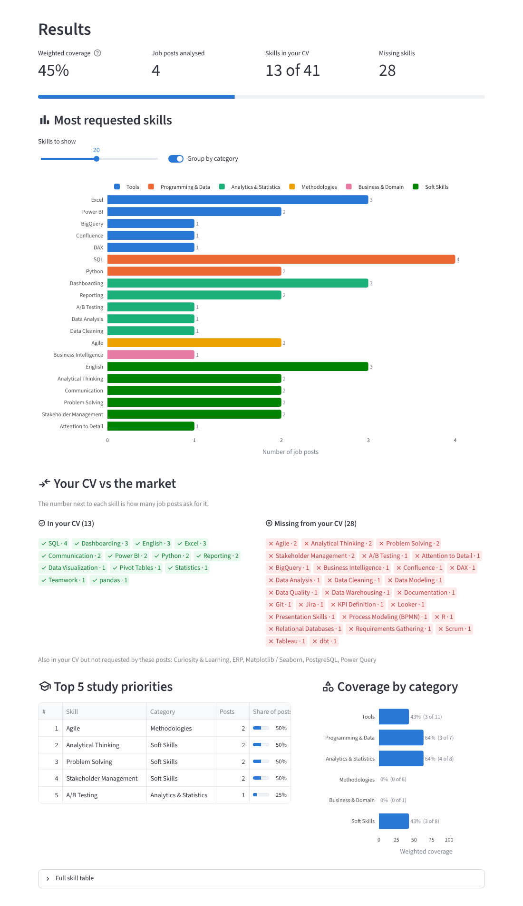

# Skill Gap Analyzer


[](https://github.com/v-ambrosino/skill-gap-analyzer/actions/workflows/tests.yml)

**Compare your CV with real job posts and see which data skills the market wants — and which ones you are missing.**

Built for people looking for **Data Analyst, BI Analyst and Business Analyst** roles, with a second dictionary for **Data Engineer / Analytics Engineer** roles (pick the target role in the sidebar).
Upload your CV (PDF), paste a few job posts (English or Italian) and get:

- the most requested skills, grouped by category;
- the skills in your CV (green) and the missing ones (red);
- a **weighted coverage score**;
- your **top 5 study priorities**.

No paid APIs, no external AI, **no data stored**.

> **Beta:** tested on real Italian and English job posts and a real CV. Skill
> detection is dictionary-based, so some wording can still be missed: please
> [open an issue](https://github.com/v-ambrosino/skill-gap-analyzer/issues) with
> the exact sentence, so it can become a new synonym and a regression test.
> See the [changelog](CHANGELOG.md) for what changed in each version.



> _Live demo: add your Streamlit Community Cloud link here once deployed._

---

## The problem

Job posts for data roles list dozens of tools, methods and soft skills, with a
different name in every post ("Power BI", "PowerBI", "PBI"; "data visualization",
"visualizzazione dati"). When you read ten posts it is hard to tell:

- which skills come up **most often**, and which are one-offs;
- how well **your CV** matches what employers ask for;
- what to **study next** to have the biggest impact.

Skill Gap Analyzer answers these three questions in a few seconds, with a
transparent method you can explain and verify.

## Features

| Feature | Details |
|---|---|
| **Input** | CV as PDF (or pasted text). Job posts in **one text box separated by `---`** or **one field per post** (add/remove fields). English and Italian. |
| **Requested skills** | Horizontal bar chart of how many posts ask for each skill, coloured and optionally grouped by category. The solid part counts posts that **require** the skill, the hatched part posts where it is only **nice to have**. |
| **CV comparison** | Skills in your CV in green, missing ones in red, each with its demand. Skills you have that the posts did not ask for are listed too. |
| **Coverage score** | Share of requested skills found in your CV, **weighted by demand** (required = 1, nice to have = 0.5, adjustable). Also shown per category. |
| **Evidence** | For any skill, the exact sentences where it was found in each post and in your CV, to check the result. |
| **Study priorities** | The 5 missing technical skills that most posts ask for. |
| **Soft skills** | Listed apart in *Soft skills to make visible in your CV*: they are shown with examples rather than studied, so they are not counted as missing, in the score or in the priorities. |
| **Export** | Download a self-contained **HTML report** (opens in any browser, prints to PDF) and the full skill table as CSV. The report holds skill names and scores only, never the CV text. |
| **Sample data** | *Load sample data* fills in fictional job posts and a fictional CV for the selected target role. |
| **Privacy** | Everything stays in memory for the session only. |

## How it works

```
CV (PDF) ──► pdf_reader ──┐
                          ├─► extractor ──► analysis ──► charts / UI
Job posts ──► split "---" ┘       ▲
                                  │
                 data/dictionaries/*.yaml (one per role)
```

1. **PDF reading** – `pdfplumber` extracts the text of the CV directly from the
   uploaded bytes, without writing a file.
2. **Normalisation** – accents, typographic quotes/dashes and extra whitespace are
   removed, so `Capacità  analitiche` and `capacita analitiche` are the same text.
3. **Skill extraction** – every synonym in the dictionary becomes a whole-word
   regular expression. A skill counts **at most once per document**.
4. **Analysis** – a pandas DataFrame with one row per requested skill:
   `skill | category | posts_count | posts_share | in_cv`. Every result is an
   aggregation of this table.

### Required vs nice to have

For job posts, the context of each mention is checked:

- **Section headers**: skills under `Nice to have:`, `Bonus:`, `Titoli preferenziali:`…
  are nice to have, until a header like `Requirements:`, `Requisiti:` or
  `Responsibilities:` starts a new section.
- **Markers in the same clause**: "Python *is a plus*", "*gradita* la conoscenza di
  Tableau", "*costituisce titolo preferenziale* la conoscenza di R". Clauses are split
  on `;` and on sentence ends, so in "Fluent English; German is a plus" English stays required.
- **Markers inside brackets** apply only to the brackets: in "SQL (BigQuery preferred)"
  SQL is required and BigQuery is nice to have.

If a skill is required anywhere in a post, it counts as required for that post.

### The coverage score

Each requested skill weighs as much as its **demand**: +1 for every post that
requires it, +0.5 for every post where it is only nice to have (the 0.5 can be
changed in the sidebar, from 0 = ignore to 1 = same as required):

```
demand   = required_count + nice_weight × nice_count
coverage = Σ demand (skills in CV) / Σ demand (all requested skills)
```

The score, the missing skills and the study priorities use **technical skills
only**. Soft skills (communication, problem solving…) get their own section: an
employer checks them through examples in the CV, so "studying" them is not the
right advice and counting them would bury the technical priorities.

Example: SQL is asked by 4 posts and is in your CV, Tableau is asked by 1 post
and is missing → coverage = 4 / (4 + 1) = **80%**. An unweighted count would say
50%, overstating a skill that only one employer wants.

### Skill dictionaries

Each target role has its own dictionary in [`data/dictionaries/`](data/dictionaries/),
with English and Italian synonyms:

| Role | File | Skills | Categories |
|---|---|---|---|
| Data Analyst / BI / Business Analyst (default) | [`data_analytics.yaml`](data/dictionaries/data_analytics.yaml) | 119 | Tools, Programming & Data, Analytics & Statistics, Methodologies, Business & Domain, Soft Skills |
| Data Engineer / Analytics Engineer | [`data_engineering.yaml`](data/dictionaries/data_engineering.yaml) | 87 | Cloud & Platforms, Programming & Databases, Pipelines & Processing, Data Architecture, Engineering Practices, Soft Skills |

Soft skills and languages live in [`shared/soft_skills.yaml`](data/dictionaries/shared/soft_skills.yaml)
and are pulled into both dictionaries with `include`, so they are maintained once.

```yaml
- name: Power BI
  category: Tools
  synonyms: [power bi, microsoft power bi, pbi]
```

Matching rules:

- **Case-insensitive and accent-insensitive** (`synonyms`).
- **Whole words only**: a match cannot touch a letter, digit, `_` or `&`.
  `sql` is not found in `NoSQL` or `MySQL`.
- Spaces and hyphens inside a phrase are interchangeable and optional:
  `power bi` also matches `Power-BI` and `PowerBI`.
- Phrases of 4+ characters also match their plural (`dashboard` → `dashboards`).
- **Short or ambiguous names** get special treatment:
  - `case_sensitive_synonyms` for exact casing: `SAS` (the software) does not match
    `Sas` (an Italian company type).
  - `patterns` (raw regex) for the hardest cases. `R` is matched only as an
    uppercase standalone word, not in `R&D`, not as a name initial (`Mario R. Rossi`)
    and not in `SAP R/3`.
  - Common words are guarded: "excel **at**" is a verb, "**reporting to** the CFO"
    is not a skill, and the Italian adjective "agile" only counts next to
    methodology words.
- The skill **name is not matched automatically**: only what is listed is matched.
- `degree_subject: true` marks skills that are also a field of study (Statistics):
  in a job post, "Laurea in Statistica o affini" is a degree requirement, so it
  does not count as a request for the skill (in the CV it still counts).
- Bullets drawn with emoji or symbols (✅, •, ▪, 🔹, common in LinkedIn posts) are
  read as line breaks, so section headers and clauses are detected correctly.

The loader validates the file at startup (unknown categories, duplicate names,
a synonym shared by two skills, invalid regex) and shows a clear error.

**Adding a role or an industry:** copy a file into `data/dictionaries/`, change
`domain`, `description`, `categories` and `skills` (and keep
`include: [shared/soft_skills.yaml]` if the soft skills fit). The app lists every
`*.yaml` file in that folder automatically, and the tests check that each one is valid.

## Project structure

```
skill-gap-analyzer/
├── app.py                     # Streamlit UI: layout, inputs, session state
├── skill_gap/
│   ├── pdf_reader.py          # PDF bytes -> text (in memory)
│   ├── normalization.py       # accent/punctuation/whitespace normalisation
│   ├── skills_dictionary.py   # load + validate YAML, compile regexes
│   ├── extractor.py           # find skills in a text, split job posts
│   ├── analysis.py            # pandas: skill table, coverage, priorities
│   ├── charts.py              # Plotly charts
│   └── report.py              # downloadable HTML report
├── data/
│   ├── dictionaries/          # one skill dictionary per role (edit me!)
│   │   └── shared/            # skills included by several roles (soft skills)
│   └── samples/               # fictional job posts and CV, one folder per role
├── tests/                     # pytest suite with fictional job posts
├── assets/screenshot.png
├── .streamlit/config.toml     # upload limit, no usage stats, theme
└── requirements.txt
```

## Run it locally

Requires Python 3.10+.

```bash
git clone https://github.com/v-ambrosino/skill-gap-analyzer.git
cd skill-gap-analyzer

python -m venv .venv
source .venv/bin/activate        # Windows: .venv\Scripts\activate
pip install -r requirements.txt

streamlit run app.py
```

The app opens at http://localhost:8501. Click **Load sample data** to try it
with fictional posts and a fictional CV for the selected target role.

### Run the tests

```bash
pip install -r requirements-dev.txt   # adds pytest
pytest
```

The same tests run automatically on GitHub Actions for every pull request and every push to `main` (Python 3.10 and 3.12), see [`.github/workflows/tests.yml`](.github/workflows/tests.yml).

The tests cover whole-word matching, Italian/English synonyms, the tricky `R`,
`SAS`, `Excel` and `Agile` cases, the post separator, the weighted coverage
score, the study priorities, dictionary validation and PDF reading.

## Deploy on Streamlit Community Cloud (free)

1. Push the repository to GitHub (a public repository is best for a portfolio).
2. Go to [share.streamlit.io](https://share.streamlit.io) and sign in with GitHub.
3. Click **Create app** → **Deploy a public app from GitHub**.
4. Pick the repository, branch `main` and main file path `app.py`.
5. (Optional) choose a custom subdomain, e.g. `skill-gap-analyzer`.
6. In **Advanced settings**, pick Python **3.12** (the version tested in CI).
7. Click **Deploy**. Dependencies are installed from `requirements.txt`
   (`requirements-dev.txt` only adds the test tools and is not needed online).

Every push to `main` redeploys the app automatically. On the free tier an app
that nobody opens for a while goes to sleep: the next visitor wakes it up with
one click, in about a minute.

## Privacy

- The CV and the job posts are kept **only in memory** (Streamlit session state)
  for the current browser session, and are discarded when the tab is closed.
- Nothing is written to disk, cached, logged or sent to third-party services or AI.
  Only the skill dictionary is cached.
- **Hosted version:** on Streamlit Community Cloud the app runs on Streamlit's
  servers, so the uploaded CV travels there (over HTTPS) and is processed in that
  server's memory, never stored by the app. For full control, run it locally.
- Usage statistics are disabled in `.streamlit/config.toml`.
- The `.gitignore` excludes `*.pdf`, so a real CV is never committed by mistake.

## Known limitations

- **Dictionary-based**: only the skills in the dictionaries are recognised, and new
  wording ("analytical" on its own, a brand-new tool) is missed until a synonym is added.
- **Limited context understanding**: required vs nice to have is detected with
  section headers and marker words, not by understanding the sentence. A list such
  as "SQL, Excel, Python is a plus" marks all three as nice to have, and a negated
  sentence ("no Python needed") still counts as a mention.
- **Ambiguous short names** are handled with conservative rules: some true
  mentions can be missed (e.g. a sentence that ends with "… Python e R.").
- **Scanned PDFs** (images without a text layer) cannot be read: there is no OCR.
- Multi-column PDF layouts may merge lines in an unusual order. This rarely
  matters for skill detection, but a phrase split across columns can be missed.
- English and Italian only.
- The coverage score measures **keyword overlap**, not proficiency or seniority.

## Future improvements

- Skill **levels** (e.g. "advanced Excel") and years of experience.
- Import job posts from a **URL** or a CSV export of a job board.
- More **dictionaries** (e.g. Data Scientist, Marketing Analyst, Finance).
- More languages (French, Spanish, German).
- Optional **OCR** for scanned CVs (e.g. Tesseract).
- A native **PDF** export (today: HTML report, printed to PDF from the browser).
- Suggested learning resources for each study priority.

## License

[MIT](LICENSE)
